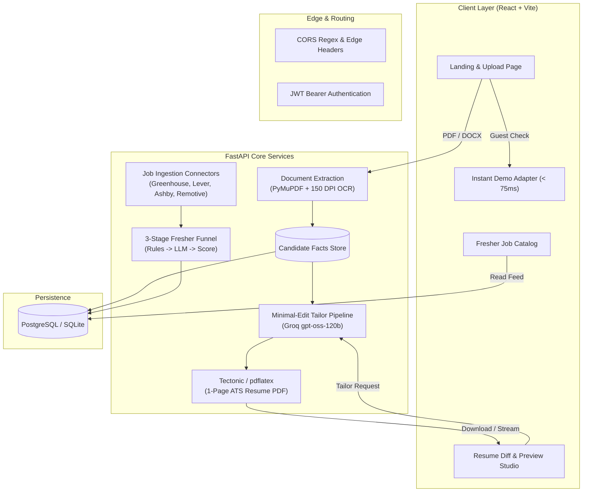

<div align="center">

# 🚀 HireMe AI

**Production-grade, early-career job platform & truthful ATS-optimized resume tailoring engine.**

[](https://frontendjob-pi.vercel.app)
[](https://hireme-zcaw.onrender.com)
[](https://fastapi.tiangolo.com)
[](https://vitejs.dev)
[](https://tailwindcss.com)
[](https://groq.com)
[](LICENSE)

[Live App](https://frontendjob-pi.vercel.app) • [API Documentation](https://hireme-zcaw.onrender.com/docs) • [Architecture](#-system-architecture) • [Quickstart](#-quickstart-guide)

</div>

---

## 📌 Overview

**HireMe AI** solves the two biggest bottlenecks faced by freshers and early-career software engineers (0–2 years experience):
1. **The Fresher Spam Problem**: Job boards flood junior applicants with "entry-level" postings secretly demanding 3–5+ years of experience or lead responsibilities.
2. **The Resume Hallucination Problem**: Generic AI resume tools fabricate metrics, invent non-existent cloud architectures, and compromise candidate integrity.

HireMe AI replaces this with a **deterministic 3-stage fresher qualification funnel** and a **truthful "minimal-edit" tailoring pipeline** that treats candidate CVs as an immutable ground-truth fact store.

---

## ✨ Core Platform Capabilities

### 1. ⚡ 1-Click Instant Demo Mode (Zero Latency)
* **Instant Client-Side Simulation**: Test all platform features (15 pre-scored jobs, full ATS analysis, side-by-side bullet diffs, LaTeX inspection, and PDF download) in **< 75ms** without creating an account or hitting backend rate limits.
* **Realistic CSE Fixtures**: Pre-populated with an authentic DTU CSE candidate profile (*Arjun Sharma*, 20 skills, 2 internships, 3 system projects) and top-tier job postings from Anthropic, Scale AI, Stripe, Datadog, and Vercel.
* **Intelligent Guest Interception**: Unauthenticated visitors dragging or clicking to upload a resume are presented with an instant choice between launching the interactive demo or creating a free account.

### 2. 🎯 Multi-Source Fresher Job Funnel & Re-Ranking
* **Direct ATS Board Connectors**: Ingests live job postings across **Greenhouse**, **Lever**, and **Ashby** boards, plus remote aggregators (*Remotive*, *Arbeitnow*, *Adzuna*, *Jobicy*, *Himalayas*).
* **3-Stage Qualification Funnel**:
  1. **Deterministic Rule Engine**: Hard-rejects any title containing `Senior`, `Lead`, `Staff`, `Principal`, `Manager`, `Director`, or requiring $\ge 3$ years of experience.
  2. **LLM Curriculum Classifier**: Evaluates educational accessibility, foundational requirements, and mentoring support.
  3. **Composite Scoring**: Ranks opportunities using a unified formula:
     $$\text{Final Rank} = \text{Fresher Score} \times \text{Candidate Skill Overlap \%}$$
* **Direct Apply Routing**: Every post delivers verified, direct links to official employer application forms.

### 3. 📄 Truthful "Minimal-Edit" Resume Tailoring
* **Immutable Fact Store**: The candidate's verified experiences, dates, degrees, companies, and project metrics are locked in an immutable fact store.
* **Strict Edit Invariants**:
  * ✅ **Permitted**: Active verb enhancement (*"worked on"* ➔ *"Architected"*), terminology normalization (*"postgres"* ➔ *"PostgreSQL"*), bullet reordering, concise trimming, and JD keyword alignment.
  * ❌ **Forbidden**: Fabricating metrics, inventing percentage claims, introducing new tools, or modifying employment dates.
* **Deterministic Post-Generation Verification**: If the LLM violates word retention thresholds ($< 60\%$) or hallucinates unsubstantiated claims, the system automatically falls back to original bullets.
* **Jake's Resume LaTeX Engine**: Formatted on single-column, standard ATS-parsed typography, compiled via standalone `tectonic` / `pdflatex` with strict 1-page line budget constraints.

### 4. 👤 Interactive Candidate Facts Studio
* **Structured Fact Management**: Visual editing for personal information, verified skills, employment history, projects, certifications, and achievements.
* **Dual-Mode Visual & JSON Editor**: Toggle between interactive visual cards and raw JSON for granular control.
* **Session Persistence**: Resumes uploaded as a guest are automatically linked to your permanent account upon sign up or login.

---

## 🏛️ System Architecture



---

## 🛠️ Technology Stack

| Domain | Technologies |
| :--- | :--- |
| **Backend Framework** | [FastAPI](https://fastapi.tiangolo.com) 0.115+, Uvicorn (ASGI) |
| **Database & ORM** | [PostgreSQL](https://www.postgresql.org) (Production) / [SQLite](https://sqlite.org) (Dev), [SQLAlchemy 2.0](https://www.sqlalchemy.org) Async, [Alembic](https://alembic.sqlalchemy.org) |
| **AI / LLM Runtime** | [Groq SDK](https://groq.com) (`openai/gpt-oss-120b`, `llama-3.3-70b-versatile`) |
| **Document Processing** | [PyMuPDF (fitz)](https://pymupdf.readthedocs.io), [EasyOCR](https://github.com/JaidedAI/EasyOCR) (150 DPI memory-optimized rasterization) |
| **Document Compilation** | [Tectonic](https://tectonic-typesetting.github.io) (Static musl binary), `pdflatex`, Jinja2 LaTeX templates |
| **Frontend Framework** | [React 18](https://react.dev), [Vite 5](https://vitejs.dev), React Router v6 |
| **Styling & UI** | [Tailwind CSS](https://tailwindcss.com), [Lucide React Icons](https://lucide.dev) |
| **Security & Auth** | [Passlib](https://passlib.readthedocs.io) (bcrypt 12 rounds), [PyJWT](https://pyjwt.readthedocs.io) (HS256) |

---

## 📂 Repository Structure

```
.
├── ai_job_platform/                # FastAPI Backend Service
│   ├── app/
│   │   ├── core/                   # Security, JWT tokens, config & DB sessions
│   │   ├── models/                 # SQLAlchemy async entity models
│   │   ├── schemas/                # Pydantic DTOs & response contracts
│   │   ├── services/               # Job aggregator, classifier, OCR extractor & tailor engine
│   │   ├── templates/              # Jake's Resume LaTeX template
│   │   ├── utils/                  # Invariant verifier & PDF rasterizer
│   │   └── routers/                # REST endpoints (auth, jobs, resume, profiles, applications)
│   ├── tests/                      # Automated test suite (pytest)
│   ├── Dockerfile                  # Production container definition (with Tectonic musl)
│   └── requirements.txt            # Python dependencies
│
├── frontend_job/                   # React + Vite Frontend Application
│   ├── public/                     # Static assets & demo tailored resume PDF
│   ├── src/
│   │   ├── api/                    # Axios client & zero-latency demo adapter
│   │   ├── context/                # AppContext (auth, active profile, demo state)
│   │   ├── components/             # Navbar, AuthModal, GuestUploadModal, JobCard, DemoBanner
│   │   ├── data/                   # Realistic static demo fixtures (demoData.js)
│   │   └── pages/                  # UploadPage, JobsPage, JobDetailPage, ProfilePage, ApplicationsPage
│   ├── package.json                # Frontend dependencies
│   └── vite.config.js              # Vite bundler configuration
│
└── README.md                       # Platform documentation
```

---

## ⚡ Quickstart Guide

### Prerequisites
* **Python**: 3.11 or newer
* **Node.js**: 18+ and npm
* **Groq API Key**: Obtain a free key from [console.groq.com](https://console.groq.com)
* *(Optional)* **Tectonic / pdflatex**: Required only for local server-side PDF compilation. (If omitted, LaTeX source code is always previewable and exportable).

---

### 1. Backend Setup

```bash
# Navigate to backend directory
cd ai_job_platform

# Create virtual environment
python -m venv venv

# Activate environment
# On Windows (PowerShell):
.\venv\Scripts\Activate.ps1
# On macOS / Linux:
source venv/bin/activate

# Install dependencies
pip install -r requirements.txt

# Configure environment
cp .env.example .env
```

Edit your `.env` configuration:
```env
APP_NAME="HireMe AI"
APP_ENV=development
DEBUG=true

# Database (Zero-config SQLite for local dev, PostgreSQL for production)
DATABASE_URL=sqlite+aiosqlite:///./ai_job_platform.db

# Groq LLM API
LLM_PROVIDER=groq
GROQ_API_KEY=your_groq_api_key_here
GROQ_MODEL=openai/gpt-oss-120b

# Security & Session Authentication
JWT_SECRET_KEY=generate_a_secure_random_key_here
JWT_ALGORITHM=HS256
JWT_ACCESS_TOKEN_EXPIRE_DAYS=7

# CORS (Allow local Vite dev server)
CORS_ORIGINS=["http://localhost:3000","http://127.0.0.1:3000"]
```

Start the FastAPI application:
```bash
python -m uvicorn app.main:app --host 127.0.0.1 --port 8000 --reload
```
Interactive API documentation is now live at `http://127.0.0.1:8000/docs`.

---

### 2. Frontend Setup

In a new terminal window:
```bash
# Navigate to frontend directory
cd frontend_job

# Install dependencies
npm install

# Start Vite dev server
npm run dev
```

Visit `http://localhost:3000` to launch the application.

---

## 🧪 Testing & Verification

Run the automated test suite covering authentication, multi-stage job classification, LLM validation, and pipeline invariants:

```bash
cd ai_job_platform
pytest tests/ -v
```

To run a production frontend build:
```bash
cd frontend_job
npm run build
```

---

## 📡 API Reference

| Method | Endpoint | Description |
| :--- | :--- | :--- |
| `POST` | `/api/v1/auth/register` | Register new user account |
| `POST` | `/api/v1/auth/login` | Authenticate credentials and receive JWT |
| `GET` | `/api/v1/auth/me` | Fetch active user session and associated profile |
| `POST` | `/api/v1/resume/upload` | Parse PDF/DOCX into immutable ground-truth facts |
| `POST` | `/api/v1/resume/tailor` | Execute minimal-edit tailoring against target job description |
| `POST` | `/api/v1/resume/{version_id}/recompile` | Toggle accept/revert on tailored bullets & recompile PDF |
| `GET` | `/api/v1/resume/{version_id}/pdf` | Stream compiled tailored resume PDF |
| `GET` | `/api/v1/resume/{version_id}/tex` | Download tailored LaTeX source document |
| `GET` | `/api/v1/jobs/recommended` | Query 3-stage qualified fresher feed (ranked by fit) |
| `POST` | `/api/v1/jobs/ingest` | Trigger multi-source ATS sync (Ashby, Lever, Greenhouse, etc.) |
| `GET` | `/api/v1/jobs/{job_id}` | Retrieve individual job specifications & skill breakdown |
| `GET` | `/api/v1/profiles/{profile_id}` | Fetch candidate facts store (skills, experience, projects) |
| `PUT` | `/api/v1/profiles/{profile_id}` | Update candidate factual information |
| `POST` | `/api/v1/profiles/{profile_id}/claim` | Bind guest-uploaded profile to authenticated account |
| `POST` | `/api/v1/applications/apply` | Save and track application submission |
| `GET` | `/api/v1/applications/{profile_id}` | List candidate application pipeline |

---

## 🌐 Production Deployment

### Backend (Render / Cloud Containers)
* Built using the production `Dockerfile` with multi-stage static musl Tectonic binary download.
* Recommended Environment Configuration:
  * `DATABASE_URL`: Managed PostgreSQL connection string (`postgresql+asyncpg://...`)
  * `GROQ_API_KEY`: Production Groq key
  * `CORS_ORIGINS`: `["https://frontendjob-pi.vercel.app"]`

### Frontend (Vercel)
* Framework Preset: **Vite**
* Root Directory: `frontend_job`
* Build Command: `npm run build`
* Output Directory: `dist`
* Environment Variables:
  * `VITE_API_URL`: `https://hireme-zcaw.onrender.com/api/v1`

---

## 📄 License

This project is licensed under the [MIT License](LICENSE). Built for early-career software engineers and job seekers worldwide.
